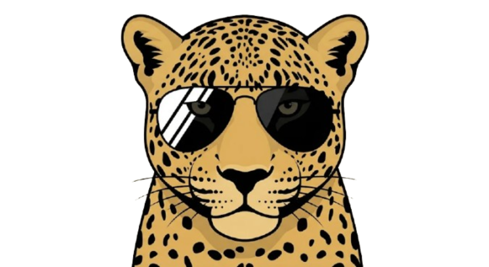
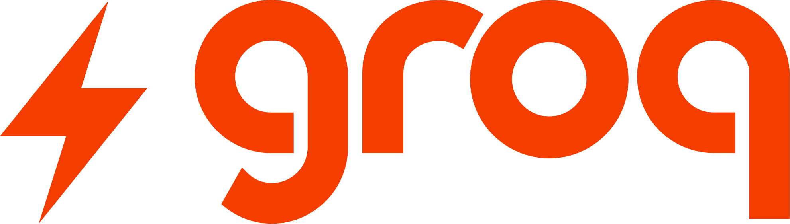

# kwach


A Go service that generates a short roast from a user's profile and recent news,
screens it with a safety model, converts it to speech, and stores profiles and chat history for context.

## Technology

| | | | |
|---|---|---|---|
|  Go |  Docker |  Groq |  ElevenLabs |
|  MongoDB |  Redis |  Google News |  nginx |

## Quick start

```sh
export $(grep -v '^#' configs/.env.example | xargs)   # example values; replace with real ones
go run ./cmd/kwach serve                             # JSON API on HTTP_ADDR (default :8080)
go run ./cmd/kwach narrate "your prompt" -out roast.mp3
```

Configuration comes only from environment variables. See [`configs/.env.example`](configs/.env.example) for the full list. The front-end in `web/static/` is served by nginx.

## Docker

```sh
docker build -t kwach .
docker run --rm -p 8080:8080 \
  --read-only --cap-drop=ALL --security-opt=no-new-privileges:true \
  --pids-limit=100 --memory=256m \
  -e GROQ_API_KEY -e ELEVENLABS_API_KEY -e ELEVENLABS_VOICE_ID -e MONGODB_URI -e REDIS_ADDR \
  kwach
```

The `-e NAME` flags pass values from your shell. The image is a static binary on distroless, runs as UID 65532, has no shell, and pins its base images by digest.

## Development

```sh
go vet ./...
go test ./...
```

## License

[MIT](LICENSE) © 2026 Oyamo
