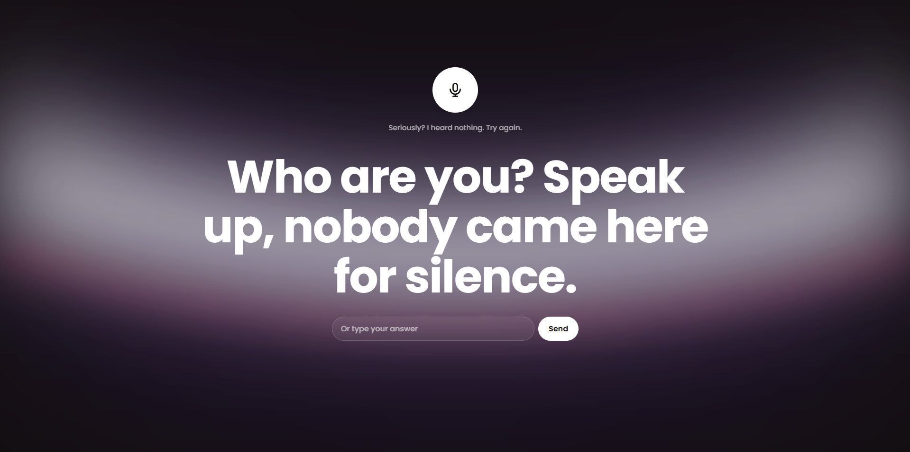

<p align="center">
  
</p>

<h1 align="center">kwach</h1>

<p align="center">
  <a href="https://github.com/oyamo/kwach/actions/workflows/ci.yml"></a>
  <a href="https://codecov.io/gh/oyamo/kwach"></a>
  <a href="go.mod"></a>
  <a href="LICENSE"></a>
</p>

kwach is an AI harness for voice roasts. It builds a prompt from a user's profile and recent headlines, checks the generated script with a guard model, then turns it into speech. The chat and guard models use the OpenAI API format, so you can switch providers with config. Profiles live in MongoDB and chat history in Redis. The front end runs the intake interview by voice.

<p align="center">
  
</p>

## Technology

<div align="center">

<table>
  <tr>
    <td align="center" valign="middle" width="180" height="64"><br>Go</td>
    <td align="center" valign="middle" width="180" height="64"><br>Docker</td>
    <td align="center" valign="middle" width="180" height="64"><br>Groq</td>
  </tr>
  <tr>
    <td align="center" valign="middle" width="180" height="64"><br>ElevenLabs</td>
    <td align="center" valign="middle" width="180" height="64"><br>MongoDB</td>
    <td align="center" valign="middle" width="180" height="64"><br>Redis</td>
  </tr>
  <tr>
    <td align="center" valign="middle" width="180" height="64"><br>Google News</td>
    <td align="center" valign="middle" width="180" height="64"><br>nginx</td>
    <td align="center" valign="middle" width="180" height="64"><br>Codecov</td>
  </tr>
</table>

</div>

## Run

```sh
go build -o kwach ./cmd/kwach
./kwach serve
```

## Docker

```sh
docker build -t kwach .
docker run --rm -p 8080:8080 \
  --read-only --cap-drop=ALL --security-opt=no-new-privileges:true \
  --pids-limit=100 --memory=256m \
  -e OPENAI_BASE_URL -e OPENAI_API_KEY -e OPENAI_MODEL -e ELEVENLABS_API_KEY -e ELEVENLABS_VOICE_IDS -e MONGODB_URI -e REDIS_URL \
  kwach
```

## Development

```sh
go vet ./...
go test ./...
```

## License

[MIT](LICENSE) © 2026 Oyamo
